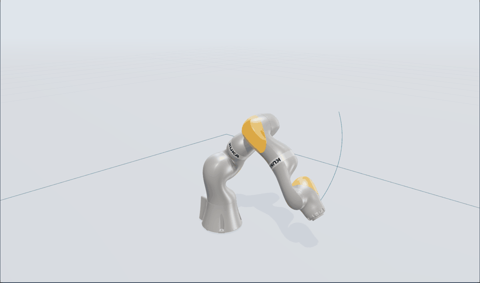

# AgenticSimEngineering

**An agent framework for engineering simulation and digital twin workflows.**

Connect language-model agents to simulation, parameter identification, asset
semantics and production monitoring through auditable CLI tools. Validate inputs,
execute models in isolated environments, compare candidates and keep results
traceable to their data and configuration.

## Simulation replay

[](assets/demo/kuka-replay.webm)

**[Watch the recording](assets/demo/kuka-replay.webm)** | **[Run the interactive viewer](#interactive-3d-viewer)**

The animation uses recorded Newton solver poses and original KUKA robot meshes.
It is a synthetic control scenario, not footage of a physical robot or evidence
of real-device accuracy.

## Features

| Workflow | What you can do |
|---|---|
| Agent orchestration | Gather missing context, invoke CLI tools and retain a tool-call ledger through the A4S Harness. |
| Simulation studies | Evaluate supplied candidates against typed inputs, units, budgets and constraints; save observations and provenance. |
| Discrete-event simulation | Run the SimPy FIFO reference case and separate FactoryFlow modelling tasks. |
| Robot dynamics | Run Newton robot examples, inspect mesh-based 3D replay and execute fixed KUKA/Panda identification workflows. |
| Field-model benchmarks | Run the PLAID Tensile2D workflow: parameter fitting, local holdout scoring and prediction export. |
| Asset semantics | Generate and check AAS structures, explicit semantic mappings, units and provenance. |
| Production monitoring | Use OPC UA monitoring and fault/maintenance workflows with AAS and MES integrations. |

Models, simulation backends, numerical algorithms, decision optimisers and agents
have separate interfaces. Optional physics engines run in their own environments;
the core has no mandatory solver or LLM dependency.

## Quick start

Requirements: **Python 3.12+**, **[uv](https://docs.astral.sh/uv/)** and Git.
Node.js/npm is needed for browser visualisation and the Harness frontend.

```bash
git clone https://github.com/quickhdsdc/AgenticSimEngineering.git
cd AgenticSimEngineering
uv sync --locked --extra des-reference
uv run --no-sync python scripts/doctor.py --profile des
uv run --no-sync python -m agenticsim study examples/queue-study.json
```

The queue example compares three supplied candidates with completion times of
8, 4 and 12 seconds. It selects `shorter-service` under the declared 8-second
constraint. The command prints the Study ID, decision and artifact path.
Results and logs are written below `work/runs/`.

```bash
uv run --no-sync python -m agenticsim capabilities
uv run --no-sync python -m agenticsim --help
```

## Interactive 3D viewer

On Windows, prepare the robot environment and viewer dependencies:

```powershell
uv sync --locked --extra des-reference
npm.cmd ci --prefix components/visualization
powershell -NoProfile -ExecutionPolicy Bypass -File scripts/bootstrap.ps1 -Profile newton
```

Double-click **[start-robot-3d.cmd](start-robot-3d.cmd)** to run the supplied
KUKA and Unitree G1 examples and open their local viewers. Keep the launcher
window open while viewing. The supplied tasks request `cuda:0`; for CPU execution,
copy a task and set `execution.device` to `cpu`.

For a single model, run and export a Study:

```powershell
uv run --no-sync python -m agenticsim study examples/kuka-iiwa14-study.json --worker-python .venvs/newton/Scripts/python.exe
uv run --no-sync python -m agenticsim visualize export <study.json>
uv run --no-sync python -m agenticsim visualize serve <bundle-directory> --port 8765
```

Use the paths printed by the preceding commands. The viewer supports playback,
camera navigation, joint inspection and candidate comparison. It runs locally
and does not require Omniverse or Isaac Sim.

## Agent-assisted workflows

```bash
uv sync --locked --extra harness --extra des-reference
uv run --no-sync python -m agenticsim.runtime.dialogue --help
uv run --no-sync python -m agenticsim.runtime.dialogue --case kuka-calibration
```

Supply your provider credentials through environment variables or a private
`.env` file, using the configuration options described by the CLI. Never commit
API keys or deployment credentials. Numerical workers do not inherit the agent's
private provider configuration.

The KUKA case generates synthetic experiments, creates an initial model, fits
damping and armature, and checks the frozen model on a separate held-out run.
The same phases are available as direct CLI commands:

```bash
uv run --no-sync python -m agenticsim calibrate generate --directory work/runs/calibration/example
uv run --no-sync python -m agenticsim calibrate model --directory work/runs/calibration/example
uv run --no-sync python -m agenticsim calibrate fit --directory work/runs/calibration/example
uv run --no-sync python -m agenticsim calibrate validate --directory work/runs/calibration/example
```

These commands require the isolated robot environment described above.

## Production and semantic workflows

```bash
uv sync --locked --extra harness --extra des-reference --extra festo
uv run --no-sync python scripts/prepare_festo_example.py
uv run --no-sync python scripts/doctor.py --profile festo
uv run --no-sync python -m agenticsim semantic --help
```

The bundled Harness provides OPC UA, AAS and MES tools. Configure endpoints for
your installation and validate asset IDs, units and signal meanings before
connecting equipment. Included Festo scenarios support local simulated testing;
they are not a commissioned connection to your plant.

## Examples and benchmarks

| Example | Entry point | Data or scenario |
|---|---|---|
| Queue comparison | [queue-study.json](examples/queue-study.json) | Deterministic reference simulation |
| KUKA robot | [kuka-iiwa14-study.json](examples/kuka-iiwa14-study.json) | Public robot geometry; synthetic control inputs |
| Unitree G1 | [unitree-g1-study.json](examples/unitree-g1-study.json) | Short posture/contact simulation |
| KUKA identification | [kuka-calibration.json](examples/kuka-calibration.json) | Synthetic experiments with a separate holdout |
| Panda identification | [panda-identification.json](examples/panda-identification.json) | Public measured robot records; fixed offline subset |
| Tensile2D | [Tensile2D brief](examples/tensile2d-benchmark-brief.md) | PLAID FEM-generated fields and prediction scoring |
| FactoryFlow / ChronoBench | [FactoryFlow brief](examples/factoryflow-benchmark-brief.md) / [ChronoBench brief](examples/chronobench-benchmark-brief.md) | Bounded model-generation tasks with simulation references |
| Screw-driving | [Screw-driving brief](examples/screw-benchmark-brief.md) | Real operation curves; workpiece-grouped train/validation/test splits |
| Semantic validation | [Semantic brief](examples/semantic-benchmark-brief.md) | Synthetic mapping challenges with AAS structural checks |

Fetch datasets separately using the corresponding tools; downloads retain their
upstream terms. Optional dependencies are listed in [environments/](environments/).
Run `scripts/doctor.py --profile <feature>` to check a selected environment.

## Execution and validation

Studies validate tasks before execution, run candidates sequentially and save
observations, constraint assessments and provenance. Successful execution and
accepted model constraints are distinct outcomes. Selecting a candidate does
not authorise a physical equipment action.

Workflows are bounded examples. General CAD-to-model generation, automatic
cross-domain co-simulation and physical validation are not provided. Tensile2D
local scores are not official hidden-test scores. G1 replay does not demonstrate
walking. Native FEM workflows require separately installed solver resources
and appropriately licensed input data.

## Tests

```bash
uv sync --locked --extra dev --extra des-reference
uv run --no-sync python -m unittest discover -s tests -v
uv run --no-sync python scripts/doctor.py --profile core
```

Integration tests need their optional environments and resources. Tests that
need unavailable dependencies are reported as skipped. GitHub Actions checks
the core and selected local integrations on Windows and Linux.

## Licensing

Original framework code is available under the scoped [MIT license](LICENSE).
Vendored software, robot assets and datasets retain their respective licenses;
see [NOTICE](NOTICE). In particular, the OpenMES snapshot is AGPL-3.0. The root
license does not override third-party terms or grant rights to external datasets,
model weights or solver distributions.
